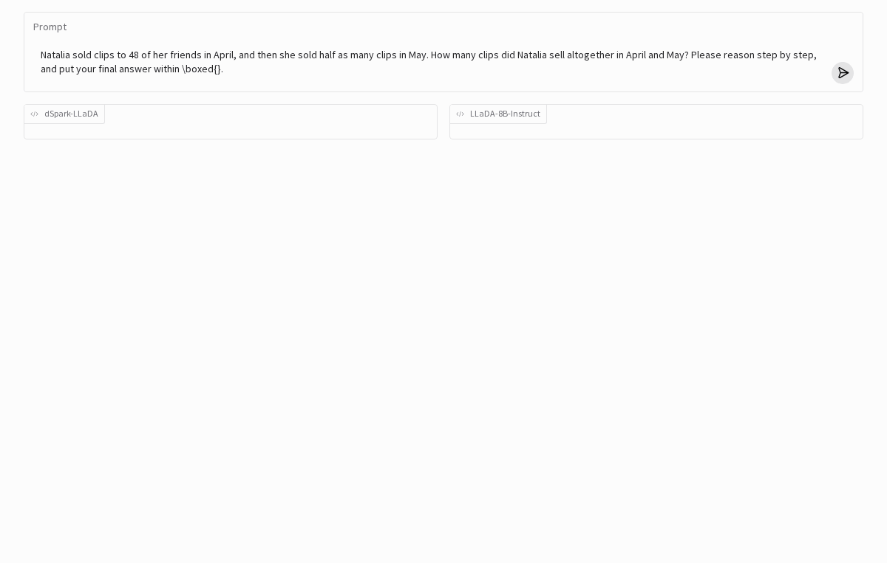
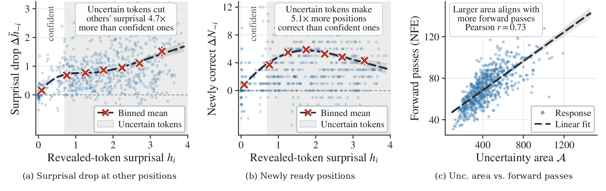
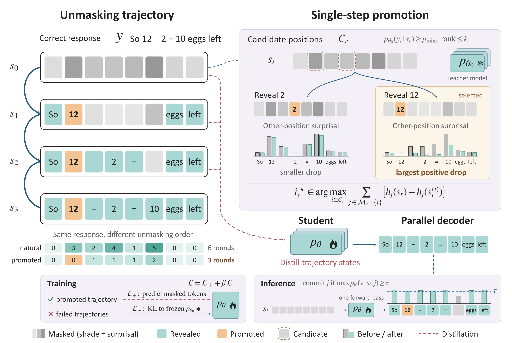
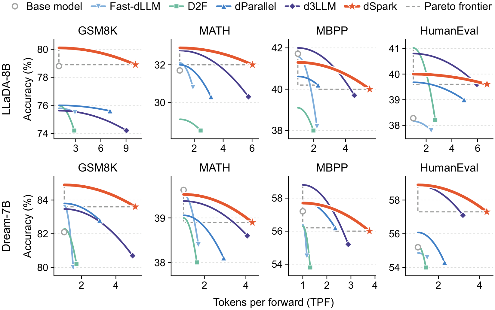

<div align="center">
<h1>⚡ dSpark: Learning When to Commit for Fast Diffusion Language Models</h1>
  <div align="center">
  <a href="#">
    
  </a>
</div>
</div>

<div align="center">
  
</div>

> **Learning When to Commit: Schedule Distillation for Fast Diffusion Language Models**
> Aidar Myrzakhan, Zhiqiang Shen
> VILA Lab, MBZUAI

**Note:** The dSpark model checkpoints and training data will be released soon.


## 💡 Introduction

We introduce dSpark, a schedule distillation framework that learns *when* to commit tokens for fast diffusion language generation. Diffusion LLMs can generate many tokens in parallel, but they often need many decoding rounds to complete a response. Efficient decoding depends not only on which tokens are easy to predict, but also on how committing them helps predict the remaining positions: a highly predictable token may provide little useful context, while revealing a less predictable one can make several other positions predictable sooner. dSpark constructs unmasking schedules that reveal such informative tokens early, distills these schedules into the model for fast parallel sampling, and preserves generation quality with a KL regularizer on the model's own failed responses. On GSM8K, dSpark decodes **10.12** and **5.12** tokens per forward with LLaDA-8B-Instruct and Dream-7B-Instruct, a **10.12×** and **5.12×** reduction in forward passes over the base models, while matching or improving their accuracy.

<div align="center">
  </img>
  <br>
  <em>
      The most predictable token is not the most useful one to reveal. On correct GSM8K responses of LLaDA, revealing an uncertain token (gray region, which confidence-based decoders defer) lowers the surprisal of the other masked positions 4.7× more (a) and makes 5.1× more of them ready (b) than revealing a confident one. (c) Responses with a larger uncertainty area need more forward passes.
  </em>
</div>
<br>

<div align="center">
  </img>
  <br>
  <em>
      Overview of dSpark. For a correct response, the frozen teacher reveals the same tokens in a new order, promoting at each round the token that most reduces the uncertainty of the other masked positions. The student is trained on the promoted trajectories, with a KL anchor to the teacher on failed ones.
  </em>
</div>
<br>


## 🔧 Installation

```bash
conda create -n dspark python=3.12
conda activate dspark
pip install -r requirements.txt
```

## 🚀 Quick Start

```python
# cd LLaDA
import torch
from transformers import AutoModel, AutoTokenizer
from generate import generate_multi_block

device = "cuda"
model_path = "output_model/dspark_llada"   # merged dSpark-LLaDA checkpoint
model = AutoModel.from_pretrained(model_path, trust_remote_code=True, torch_dtype=torch.bfloat16).to(device).eval()
tokenizer = AutoTokenizer.from_pretrained(model_path, trust_remote_code=True)

prompt = "Natalia sold clips to 48 of her friends in April, and then she sold half as many clips in May. How many clips did Natalia sell altogether in April and May? Please reason step by step, and put your final answer within \\boxed{}."
m = [{"role": "user", "content": prompt}]
prompt = tokenizer.apply_chat_template(m, add_generation_prompt=True, tokenize=False)
input_ids = torch.tensor(tokenizer(prompt, add_special_tokens=False)["input_ids"]).to(device).unsqueeze(0)

out, nfe = generate_multi_block(model, input_ids, gen_length=256, block_length=32, factor=0.95)
print("Response:", tokenizer.decode(out[0, input_ids.shape[1]:], skip_special_tokens=True))
print("NFE:", nfe)
```

We also provide a Gradio demo, shown at the top of this page: dSpark-LLaDA and LLaDA-8B-Instruct with standard decoding decode the same prompt one after the other, and the two runs are replayed side by side at their real speed.
```bash
pip install gradio==6.14.0
cd LLaDA
python app.py --model_path output_model/dspark_llada
```

## 📊 Data Preparation

The training data is generated by the base model on GSM8K, PRM12K, NuminaMath-CoT and AceCode problems (plus OpenMathInstruct-2 for Dream), with at most 256 new tokens and a block size of 32. Each response is checked against the reference answer or the unit tests. For every correct response, the frozen model constructs its unmasking schedule; incorrect responses are kept as failed trajectories for the KL regularizer. The script runs one process per GPU, writes `data/shard_<i>.jsonl` and resumes where it stopped.

For LLaDA:
```bash
cd LLaDA
bash data_prepare.sh
```

For Dream:
```bash
cd Dream
bash data_prepare.sh
```

## 🔥 Training

### 1. Schedule Distillation with LoRA

We provide training scripts for schedule distillation with LoRA. The configuration is specified in [config_lora_llada.yaml](LLaDA/configs/config_lora_llada.yaml) and [config_lora_dream.yaml](Dream/configs/config_lora_dream.yaml); we train each model on 4 A100 GPUs. All correct trajectories are used, and failed trajectories are subsampled to a 4:1 ratio.

For LLaDA:
```bash
cd LLaDA
deepspeed --master_port 29501 --include localhost:0,1,2,3 llada_train.py
```

For Dream:
```bash
cd Dream
deepspeed --master_port 29501 --include localhost:0,1,2,3 dream_train.py
```

### 2. LoRA Merge

After training, merge the LoRA weights to get the dSpark model.

For LLaDA:
```bash
cd LLaDA
python merge_lora.py
```

For Dream:
```bash
cd Dream
python merge_lora.py
```

## ⚡ Evaluation

We provide evaluation scripts for GSM8K, MATH, HumanEval and MBPP based on [lm-evaluation-harness](https://github.com/EleutherAI/lm-evaluation-harness). Besides accuracy, the log reports the decoding speed as tokens per forward (TPF).

For LLaDA:
```bash
cd LLaDA
sh eval.sh
```

For Dream:
```bash
cd Dream
sh eval.sh
```

Note that HumanEval, MBPP and the data preparation of AceCode problems execute model-generated code.

## 📖 Experimental Results

### Main Results

Each cell reports accuracy (%) / TPF / AUP. TPF is the number of tokens per forward pass, and AUP (accuracy under parallelism) combines accuracy and parallelism into one score.

**LLaDA-8B-Instruct**

| Method | GSM8K | MATH | MBPP | HumanEval |
|:--|:--:|:--:|:--:|:--:|
| Base model | 78.8 / 1.00 / 78.80 | 31.7 / 1.00 / 31.70 | **41.7** / 1.00 / 41.70 | 38.1 / 1.00 / 38.10 |
| Fast-dLLM | 75.5 / 2.91 / 199.24 | 30.8 / 1.91 / 46.24 | 38.2 / 2.20 / 57.33 | 37.8 / 2.39 / 52.30 |
| D2F | 74.2 / 2.83 / 190.87 | 28.5 / 2.44 / 45.96 | 38.0 / 1.98 / 50.70 | 38.2 / 2.71 / 60.59 |
| dParallel | 75.6 / 7.09 / 469.03 | 30.3 / 3.16 / 64.57 | 40.2 / 2.27 / 59.46 | 39.0 / 4.95 / 83.88 |
| d3LLM | 74.2 / 9.05 / 571.28 | 30.3 / 5.75 / 107.59 | 39.7 / 4.56 / 91.88 | **39.6** / 5.95 / 96.58 |
| **dSpark (ours)** | **78.9** / **10.12** / **761.67** | **32.0** / **6.03** / **119.55** | 40.0 / **5.52** / **104.94** | **39.6** / **6.73** / **106.19** |

**Dream-7B-Instruct**

| Method | GSM8K | MATH | MBPP | HumanEval |
|:--|:--:|:--:|:--:|:--:|
| Base model | 82.1 / 1.00 / 82.10 | **39.5** / 1.00 / 39.50 | **57.0** / 1.00 / 57.00 | 55.2 / 1.00 / 55.20 |
| Fast-dLLM | 80.0 / 1.52 / 122.01 | 38.4 / 1.71 / 53.87 | 54.5 / 1.17 / 62.75 | 54.6 / 1.45 / 66.76 |
| D2F | 80.2 / 1.71 / 132.39 | 38.0 / 1.64 / 51.32 | 53.8 / 1.31 / 67.52 | 54.0 / 1.39 / 66.78 |
| dParallel | 82.8 / 3.06 / 246.01 | 38.1 / 2.93 / 76.76 | 56.2 / 2.35 / 113.76 | 54.3 / 2.30 / 91.46 |
| d3LLM | 80.7 / 4.97 / 379.09 | 38.6 / 4.07 / 101.47 | 55.2 / 2.89 / 137.54 | 57.1 / 3.19 / 129.15 |
| **dSpark (ours)** | **83.6** / **5.12** / **424.28** | 38.9 / **4.31** / **106.58** | 56.0 / **3.77** / **171.43** | **57.3** / **4.35** / **167.17** |

### Better Accuracy-Parallelism Trade-off



### Wall-Clock Speed

Accuracy and throughput on GSM8K with LLaDA-8B-Instruct on an A100 GPU with batch size 1 (TPS: tokens per second). dSpark is 16.6× faster than the base model.

| Model | Acc. (%) | TPF | TPS |
|:--|:--:|:--:|:--:|
| LLaDA | 78.82 | 1.00 | 15 |
| Fast-dLLM | 75.51 | 2.91 | 94 |
| D2F | 74.24 | 2.83 | 89 |
| dParallel | 75.62 | 7.12 | 165 |
| d3LLM | 74.21 | 9.05 | 220 |
| **dSpark (ours)** | **78.94** | **10.12** | **249** |

## ☀️ Acknowledgement

Our code builds on [LLaDA](https://github.com/ML-GSAI/LLaDA), [Dream](https://github.com/DreamLM/Dream), [Fast-dLLM](https://github.com/NVlabs/Fast-dLLM), [dParallel](https://github.com/czg1225/dParallel), [d3LLM](https://github.com/hao-ai-lab/d3LLM) and [lm-evaluation-harness](https://github.com/EleutherAI/lm-evaluation-harness), and we acknowledge these great works for laying the groundwork that made our approach possible.

## Citation

If our research assists your work, please give us a star ⭐ or cite us using:
```
@article{myrzakhan2026dspark,
  title={Learning When to Commit: Schedule Distillation for Fast Diffusion Language Models},
  author={Myrzakhan, Aidar and Shen, Zhiqiang},
  journal={arXiv preprint},
  year={2026}
}
```
